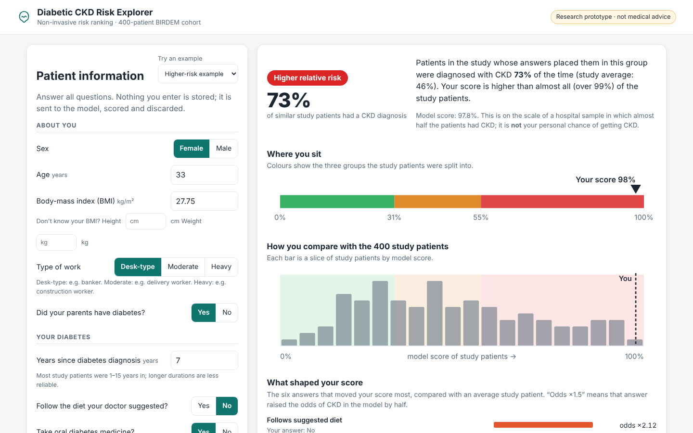

# Diabetic CKD Risk Explorer

[](https://github.com/PanzerFaustAnan/diabetic-ckd-risk-app/actions/workflows/ci.yml)

**Live demo: https://diabetic-ckd-risk-app.onrender.com/** (free hosting: the first load can take about a minute while the server wakes up)

A research-prototype web app that ranks chronic-kidney-disease (CKD) risk for diabetic patients from 20 non-invasive
questionnaire features, explains the result, and shows general guideline-based health guidance.
Built end-to-end: model evaluation → FastAPI service → Docker → CI → cloud deployment.



> **Not a medical device.** Trained on 400 patients from one hospital (BIRDEM, Dhaka). It ranks risk in a population like the study sample;
> it does not diagnose. See "Honest limitations".

## What the user sees
* A form for 20 answers (with a BMI helper), validated in the browser and again on the server.
* A **risk group** (lower / moderate / higher) with the *observed* CKD rate of study patients in that group, the percentile among the study patients, and two charts.
* **What shaped the score**: the six answers that moved it most (exact linear SHAP, shown as odds multipliers).
* **Model notes** that openly flag two features whose model direction contradicts clinical knowledge (regular walking, hypertension).
* **General health guidance** written from public diabetes/kidney guidelines (independent of the model; pending clinician review).
* A **what-if explorer** showing how the model's score reacts to changing one answer (labelled as model sensitivity, not advice).

## Architecture
```
 Browser (static/index.html + app.js)
     │  JSON over HTTP
     ▼
 FastAPI  app/main.py ──validates──► schemas.py (Pydantic, strict types)
     │                       │
     │                       ├─► model_service.py ─► artifacts/model_params.json  (scaler + logistic-regression coefficients)
     │                       └─► guidance.py        (rule-based, guideline text)
     ▼
 /predict  /sensitivity  /model-info  /examples  /health  /docs
```

## Quick start (local)
```bash
python -m venv venv
source venv/bin/activate          # Windows PowerShell: venv\Scripts\Activate.ps1
pip install -r requirements-dev.txt
python -m pytest -q               # 25 tests should pass
ruff check .                      # linter
uvicorn app.main:app --reload     # then open http://127.0.0.1:8000  (API docs: /docs)
```

## Docker
```bash
docker build -t ckd-risk-app .
docker run --rm -p 8080:8080 ckd-risk-app      # open http://localhost:8080
```

## API
| Method | Path | Purpose |
|---|---|---|
| POST | `/predict` | Score one patient: tier, observed tier rate, percentile, drivers, notes, guidance, warnings |
| POST | `/sensitivity` | Model score as one feature varies (what-if) |
| GET | `/model-info` | Metrics, limitations, tier cut-points, valid ranges |
| GET | `/examples` | Example patient payloads |
| GET | `/health` | Liveness probe |

Example:
```bash
curl -X POST http://127.0.0.1:8000/predict -H "Content-Type: application/json" \
  -d '{"sex":0,"job":1,"fam":0,"dy":5,"age":50,"bmi":24,"diet":1,"med":1,"ins":0,"htn":0,"hd":0,"sleep":1,"water":1,"smoke":0,"zarda":0,"walk":1,"urin":1,"uti":0,"pk":0,"cal":1400}'
```
The full schema is in the interactive docs at `/docs`.

## Repository map
```
app/            main.py (routes, security headers) · schemas.py (validation) · model_service.py (model logic) · guidance.py (advice rules) · static/ (UI)
artifacts/      model_params.json (coefficients) · model_metadata.json (metrics, ranges, tiers) · example_requests.json
tests/          model, guidance and API tests (25)
assets/         screenshot used in this README
Dockerfile · .github/workflows/ci.yml · .github/dependabot.yml · requirements*.txt · ruff.toml
```

## Key design decisions
* **Honest evaluation:** nested, repeated, patient-level cross-validation; AUC ≈ 0.75 (95% CI 0.71–0.80), calibration slope 1.07.
* **Simple model:** regularised logistic regression; all model families were statistically tied, so the simplest won (one-standard-error rule).
* **No pickle at runtime:** the trained scaler and logistic regression are exported as plain numbers (`model_params.json`) and the score is
  computed directly. The service therefore needs neither scikit-learn nor joblib, the image is smaller, and no executable file format is loaded.
  Golden-value tests check that the scores match the original scikit-learn pipeline.
* **Explanations without the SHAP library:** for a linear model, SHAP has a closed form; it is computed directly and tested for exact additivity.
* **Two separate layers:** model output (descriptive) vs guideline advice (never derived from the model).
* **Defensive API:** strict input types, unknown fields rejected, request-size limit, validation errors that never echo submitted values,
  security headers (Content-Security-Policy, no framing), `no-store` on prediction responses, non-root container.

## Honest limitations
Case-enriched sample (46% CKD) so scores are not population risks · single hospital, n = 400, lifestyle data collected by survey alongside the
patients' diabetes record books · associations are not causal · training data are thin beyond ~15 years of diabetes · no external validation ·
guidance text awaits clinician review.

## Data
Dataset: *A dataset of demographic and lifestyle risk factors for assessing chronic kidney disease development in diabetic patients*,
Data in Brief (2026); Mendeley Data, doi:[10.17632/hjkzgbxgv5.2](https://doi.org/10.17632/hjkzgbxgv5.2).

## Author and licence
Built by Ahmed Anan ([GitHub](https://github.com/PanzerFaustAnan)). Code released under the [MIT licence](LICENSE).
